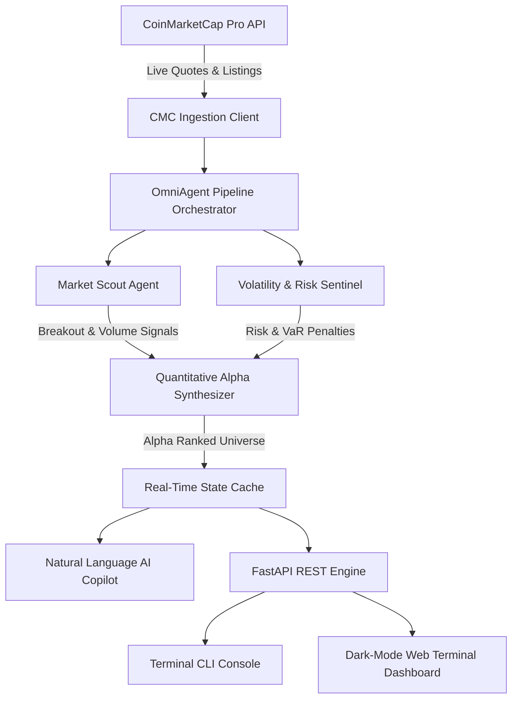

# ⚡ CMC-OmniAgent
### Autonomous Crypto Intelligence, On-Chain Alpha & Risk Copilot
**Built for the CoinMarketCap API Hackathon (Round 2) on DoraHacks**  
**Track:** *AI Agents and Automation* | **Author:** `@givemehat` (Rajnish Singh)

---

## 🌟 Executive Summary

Crypto markets operate 24/7/365 across tens of thousands of liquid pairs. Institutional quantitative desks rely on multi-tier telemetry and algorithmic pipelines, while retail and mid-tier traders face cognitive overload, emotional execution, and fragmented analytics.

**CMC-OmniAgent** is an autonomous, multi-agent market intelligence platform powered by the **CoinMarketCap Developer API**. It continuously synthesizes live global metrics, detects volume and price breakouts, calculates mathematical volatility risk, generates composite alpha rankings, and features an interactive natural language analytical Copilot.

---

## 🏗️ Architecture & Multi-Agent Design



### The 4 Specialized Autonomous Agents:
1. **Market Scout Agent (`cmc_agent.agents.scout`):**
   * Continuously scans CoinMarketCap listings for abnormal turnover (Volume-to-Market-Cap ratio > 12%), multi-timeframe breakouts (1h, 24h, 7d), and quiet accumulation ranges.
   * Assigns deterministic confidence scores (0.0 to 1.0) and severity ratings.
2. **Volatility & Risk Sentinel (`cmc_agent.agents.sentinel`):**
   * Evaluates tail volatility, liquidity depth, and downside drawdown vulnerability.
   * Classifies assets into `LOW`, `MODERATE`, and `HIGH` risk profiles with actionable warning flags.
3. **Quantitative Alpha Synthesizer (`cmc_agent.agents.alpha`):**
   * Multi-factor scoring model combining:
     $$\text{Composite Alpha} = 0.40 \times \text{Momentum} + 0.35 \times \text{Volume Quality} + 0.25 \times \text{Stability}$$
   * Produces an institutional-grade recommendation matrix (e.g. *Strong Overweight*, *Accumulate on Dips*, *Market Weight*, *Underweight*).
4. **Natural Language AI Copilot (`cmc_agent.agents.copilot`):**
   * Context-aware conversational agent answering analytical queries (e.g., *"Analyze SOL vs BTC price & liquidity risk"* or *"What is current market overview and dominance?"*).

---

## 📊 CoinMarketCap Endpoints Integrated

* `/v1/cryptocurrency/listings/latest`: Live asset prices, 24h volumes, market capitalizations, circulating supply, and multi-window percentage changes.
* `/v1/global-metrics/quotes/latest`: Global crypto market cap, aggregate 24h volume, Bitcoin dominance, Ethereum dominance, and active cryptocurrency counts.
* `/v1/cryptocurrency/quotes/latest`: Single and multi-symbol real-time telemetry.

> **Zero-Friction Evaluation:** CMC-OmniAgent includes a realistic offline sandbox feed. Evaluators and judges can run the full system immediately without an API key, or plug in a live CoinMarketCap API key for production streams.

---

## 🚀 Quickstart & Setup

### 1. Clone & Run with Python
```bash
git clone https://github.com/givemehat/cmc-omniagent.git
cd cmc-omniagent
```

### 2. Configure Environment (Optional)
```bash
cp .env.example .env
# Add your CMC_API_KEY in .env (or run in default evaluation mode)
```

### 3. Run the Terminal CLI Scanner
```bash
python3 cli.py
```

### 4. Launch the Interactive Web Dashboard
```bash
# Install dependencies (optional if running standalone)
pip install -r requirements.txt

python3 app.py
```
Open **`http://localhost:8000`** in your browser to view the live dashboard!

---

## 🧪 Test Suite

Run the automated test suite verifying client ingestion, agent signals, and copilot reasoning:
```bash
python3 -m unittest tests/test_pipeline.py
```

---

## 📜 License
MIT License • Open Source for the CoinMarketCap & Web3 Community.
